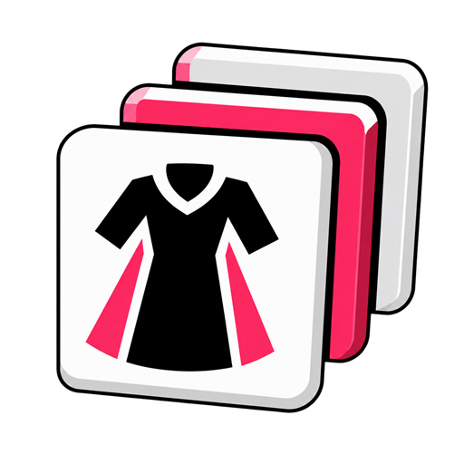

<p align="center">
  
</p>

# Better Glamour Plates

Better Glamour Plates brings your Glamour Dresser and Armoire into one searchable
wardrobe. Save outfit ideas, preview their colours, and load them into FFXIV's
Glamour Plates when you are ready.

## Features

- Browse your Glamour Dresser and Armoire together using Exportaramus.
- Keep an unlimited local library of outfits without using native plate slots.
- Name, duplicate, and assign icons to saved outfits.
- Preview outfits with their chosen dyes or their default colours.
- Save another player's displayed glamour from Examine.
- Load available pieces into the open Glamour Plate and identify missing items.
- Uses a Native Pearl interface beside the game's Glamour Plate Creation window.

## Installation

You need XIVLauncher with Dalamud enabled and **Exportaramus** installed and up
to date. This build uses its CollectionData 1.2 interface. Older versions that
only provide 1.1 cannot supply collection data; your saved outfits remain intact.
The steps below apply once Better Glamour Plates is listed in the Plugin Installer.
If you already added our repository, skip to step 4.

1. Open Dalamud Settings with `/xlsettings` in game.
2. Under **Experimental → Custom Plugin Repositories**, paste this URL:

   ```text
   https://raw.githubusercontent.com/OhGodAGirl/FFXIV/main/pluginmaster.json
   ```

3. Click **+**, then **Save**.
4. Open the Plugin Installer with `/xlplugins`, search for **Exportaramus**,
   and select **Install** if it is not already installed.
5. Search for **Better Glamour Plates** and select **Install**.

## Usage

1. In Exportaramus, use **Dresser & Armoire** to refresh your stored items.
2. Open **Glamour Plates** from your Glamour Dresser. Better Glamour Plates opens
   beside the native character preview.
3. Choose a saved outfit, select **New**, or use **Save Current** to copy the
   selected native plate into your local library.
4. Select an equipment slot, then choose an item from the collection.
5. Click a colour swatch beneath an item to choose its dye. Select **Dyed** or
   **Undyed** to preview the outfit with or without its chosen colours.
6. Select **Load Into Current Plate** to load the outfit using that dye choice.
7. Review the native plate and use FFXIV's **Save** to keep it.

Previewing does not load the native plate or consume materials. Better Glamour
Plates does not move or store equipment, and never presses FFXIV's **Save**.

### Saved Outfits

Use the search icon beside **Saved Plates** to find an outfit. Click its icon to
choose a replacement, or use the pencil, duplicate, and trash icons to rename,
copy, or delete it. A duplicate appears above its original. Deletion immediately
removes the local entry.

Item and dye edits remain drafts until you select **Save Changes** in the outfit
panel. **Reset Changes**, switching outfits, or closing the plugin restores the
last saved outfit. Right-click an item to clear its slot in the draft.

**Clear Items** empties the draft and clears the open native plate after readiness
checks. **Reset Changes** restores only the local outfit; use **Load Into Current
Plate** to put its items back into the native plate.

### Dyes And Loading

The dye drawer groups colours into Regular and Special dyes, with search and
three clearing controls:

- **Clear Selected** removes the selected item's chosen dye channel.
- **Clear Both** removes both dye channels from that item.
- **Clear All** removes dyes from the entire outfit.

Choosing a dye switches preview to **Dyed**. **Undyed** shows default colours
without erasing the dyes in your saved outfit. The selected preview option also
controls the colours used by **Load Into Current Plate**.

Available pieces load; missing pieces are skipped and their native slots remain
untouched. Missing items appear faded after a load attempt. Empty outfit slots
clear the corresponding native slots. Unavailable collection data does not mean
an item is missing.

Matching stored colours need no extra dye. Colour changes or removal may require
dye or Terebinth; missing materials stop the load with an explanation. Save or
discard pending native dye changes before loading another outfit. If the game
rejects an action partway through, inspect the reported result and native plate
before saving.

### Save Another Player's Glamour

Examine a player and select **Save Glamour**, beneath the glasses slot opposite
the Job Stone. The outfit captures their displayed glamour and dyes. Saving a
look does not mean you own its items.

Outfit names, items, dyes, and icons stay in your local plugin configuration.
Better Glamour Plates sends no telemetry.

### Troubleshooting

Run `/betterplates diagnostics` and select **Copy Diagnostics** for a support
report. Reports omit player names, account identifiers, private paths, and
inventory lists.

[Report a problem](https://github.com/OhGodAGirl/FFXIV/issues) with your plugin
version, reproduction steps, expected and actual behaviour, and diagnostics.
For layout issues, include your resolution and UI scale. Remove unrelated names,
chat, and account details from screenshots before sharing.

## Commands

Better Glamour Plates opens automatically with the native Glamour Plate editor.

`/betterplates diagnostics` — Open diagnostics for troubleshooting.

## License

[MIT](LICENSE)


