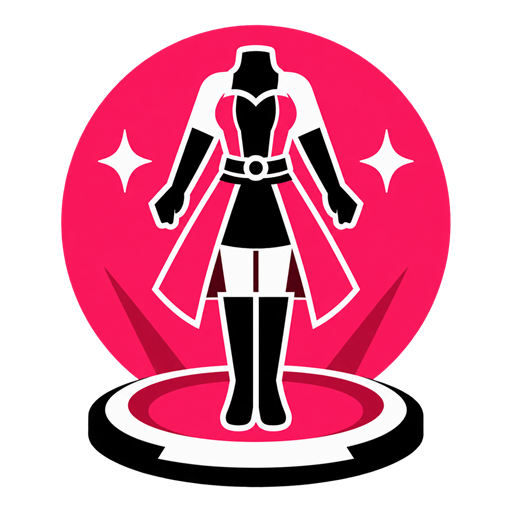

<p align="center">
  
</p>

# Collection Shopper

Collection Shopper turns missing collectibles into a Market Board shopping list.
See what you still need, compare price estimates, and purchase items within the
gil limits you choose.

## Features

- Shops for outfits, weapons, minions, mounts, orchestrion rolls, hairstyles,
  glasses, and fashion accessories that can be sold on the Market Board.
- Uses Exportaramus collection and storage observations to exclude owned items.
- Shows Universalis price estimates for your current world.
- Purchases individual items or works through a category with **Buy All**.
- Applies per-item and per-run spending limits, including Market Board tax.
- Offers category tabs, text filtering, tab styles, and **Reduce Motion**.

## Installation

Collection Shopper is currently available as source. A downloadable release has
not been published yet. The installation steps below apply once it is listed.


You need XIVLauncher with Dalamud enabled and **Exportaramus 1.0.0.3** installed
and loaded. If you already added our repository, skip to step 4.

1. Open Dalamud Settings with `/xlsettings` in game.
2. Under **Experimental → Custom Plugin Repositories**, paste this URL:

   ```text
   https://raw.githubusercontent.com/OhGodAGirl/FFXIV/main/pluginmaster.json
   ```

3. Click **+**, then **Save**.
4. Open the Plugin Installer with `/xlplugins`, search for **Exportaramus**,
   and select **Install**. Repeat for **Collection Shopper** when available.

## Usage

1. In Exportaramus, select **Sync Now**. Use **Dresser & Armoire** and
   **Retainers** to refresh stored items when needed.
2. Open a Market Board and select Collection Shopper's **Settings** tab.
3. Select **Refresh**, then set **Maximum Gil per Item** and
   **Maximum Gil for This Run**. **Unlimited Gil per Item** and
   **Unlimited Gil for This Run** remove their corresponding limits. **Allow HQ Purchases** permits either NQ or HQ items; off means NQ only.
4. Choose a category or **All Missing** and review the list. Use
   **Filter Item or Collection** to find an item, then select **Buy** or **Buy All**.
5. Follow the highlighted item and purchase progress. The square Stop control,
   labeled **Cancel Automated Purchasing** on hover, stops further requests.
   Closing the Market Board also stops the run.

**Tab** controls which category tabs appear. **Purchases** controls which
categories **Buy All** includes on **All Missing**; an individual category's
**Buy All** stays within that category. **Tab Style** changes the tabs' appearance.
**Reduce Motion** uses a static purchase highlight and less automatic scrolling.

### Collections and Prices

Keep Exportaramus loaded. Collection Shopper uses its observations of inventory,
Armoury Chest, both saddlebags, retainers, Armoire, Glamour Dresser, and collection
unlocks. Complete current or last-known storage observations can identify owned
items; unknown or incomplete sources never prove an item is missing. Permanent
unlock checks also need fresh, complete observations. **Unverified** items cannot
be purchased. Hover over collection status for details about unavailable sources.

**Hide Locally Owned** filters owned items from the list. Confirmed purchases are
remembered across characters on this installation to prevent repeat purchases;
this history does not prove a permanent unlock.

Prices refresh when you open the Market Board or select **Refresh**.
**Automatically Refresh Collection** loads catalogs and prices automatically;
it does not continuously poll prices. **Checking** means a price lookup is in
progress. **Not Found** means no usable Universalis estimate is loaded for the
current world and allowed quality. Its tooltip reads “No Universalis Price - Check Marketboard”.
Live listings may still exist, and **Buy** and **Buy All**
can search for them. Estimates may be outdated; the displayed total covers only
priced items and excludes tax.

Purchases use live listings and your tax-inclusive limits. Collection Shopper
requests one item at a time and waits for confirmation before continuing. If a
listing changes or a purchase cannot be confirmed, the run stops. Read the status
and check your inventory before trying again; an uncertain purchase is not
retried automatically. A world or character change invalidates the old shopping
context, so refresh before starting another run.

### Data and Troubleshooting

FFXIV Collect supplies public catalog metadata. Universalis receives requested
item IDs and your current world for price estimates. Collection Shopper does not
upload your inventory, character identifier, credentials, or chat. Settings and
confirmed purchase history are saved locally.

Run `/collectionshopper diagnostics`, then select **Run Checks** to inspect local
readiness. These checks do not contact either service or change game state.
**Pass** applies only to the inspected state; **Warning**, **Failure**,
**Waiting**, and **Not Available** explain what needs attention or could not be
checked. Select **Copy Diagnostics** for a redacted report and review it before
sharing.

[Report a problem](https://github.com/OhGodAGirl/FFXIV/issues) with the plugin
version, what you selected, what happened, and the diagnostics report. Remove
personal information from screenshots and logs.

## Commands

`/collectionshopper` — Open or close Collection Shopper.

`/glamshop` — Alias for `/collectionshopper`.

`/collectionshopper diagnostics` — Open diagnostics for troubleshooting.

`/collectionshopper motion` — Start logging for tab motion troubleshooting.

## For Developers

### Building From Source

On Windows, install Git and the .NET SDK specified in `global.json`. Set
`DALAMUD_HOME` to the directory containing the Dalamud API 15 development
assemblies. To download, build, and test the source, run:

```powershell
git clone https://github.com/OhGodAGirl/FFXIV.git
cd FFXIV/CollectionShopper
dotnet restore CollectionShopper.slnx --locked-mode
dotnet build CollectionShopper.slnx -c Release --no-restore -p:ShouldUnsetParentConfigurationAndPlatform=false
dotnet test tests/CollectionShopper.Tests/CollectionShopper.Tests.csproj -c Release --no-build --no-restore -- xUnit.MaxParallelThreads=2
```

### Directory Layout

- `src/` — Plugin code, interface, and purchase controls.
- `data/` — Bundled outfit definitions and contract data.
- `src/Contracts/1.2/` — Pinned Exportaramus collection-data client.
- `data/Contracts/1.2/` — Contract schemas, resources and provenance.
- `tests/fixtures/Contracts/1.2/fixtures/` — Pinned contract fixtures.
- `project/Contracts/1.2/` — Separate contract assembly project.
- `images/` — Plugin icon.
- `tests/` — Automated tests and test configuration.

The project, solution, dependency locks, build configuration, README, license,
SDK selection, Git exclusions, and editor settings live at the top level.

## License

[MIT](LICENSE)
